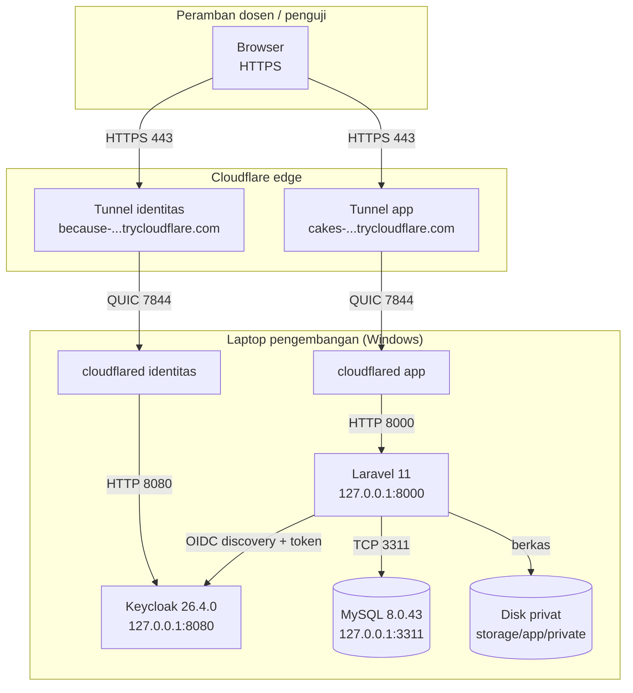

**Status:** Ada. Deployment diagram final untuk staging, 27 November 2026.

# P14 — Deployment Diagram Final (Staging)

**Pemilik:** Mahesa Kanaka Raya (Network/DevOps)
**Bentuk:** laptop pengembangan + dua tunnel Cloudflare. Bukan VPS, sesuai SK-026.

## 1. Diagram

## 2. Node dan artefak

| Node | Artefak | Protokol / port | Keterangan |
|---|---|---|---|
| Browser penguji | HTML, CSS, gambar | HTTPS 443 | tidak memasang apa pun |
| Cloudflare edge | terowongan publik | HTTPS 443 | TLS berakhir di Cloudflare |
| `cloudflared` app | biner cloudflared 2026.11.2 | QUIC 7844 keluar | meneruskan ke 8000 |
| `cloudflared` identitas | biner yang sama | QUIC 7844 keluar | meneruskan ke 8080 |
| Laravel | `08_Source` PHP 8.4 | HTTP 8000 loopback | BFF, sesi, halaman |
| Keycloak | 26.4.0, JRE 21 | HTTP 8080 loopback | realm `sewakampus` |
| MySQL | 8.0.43 | TCP 3311 loopback | 14 tabel, 1 view |
| Disk privat | `storage/app/private` | — | foto barang dan handover |

## 3. Alur login

1. Penguji membuka URL aplikasi.
2. Laravel mengarahkan ke Keycloak melalui tunnel identitas, membawa PKCE S256.
3. Keycloak mengembalikan kode ke `https://<app>/auth/keycloak/callback`.
4. Laravel menukar kode, mencocokkan email ke tabel `users`, lalu membuat sesi.

## 4. Perbedaan dengan arsitektur target

| Target (TRD) | Staging ini | Alasan |
|---|---|---|
| Satu VPS Ubuntu + Docker Compose | laptop Windows, proses langsung | belum ada VPS (SK-026) |
| Nginx + TLS | Cloudflare edge | TLS ditangani Cloudflare |
| Redis, MinIO, worker | belum dijalankan | belum dibutuhkan untuk lima Must |
| IP publik tetap | nama tunnel sementara | tanpa biaya, cukup untuk demo |

## 5. Pemeriksaan kesehatan

| Pemeriksaan | Perintah | Hasil benar |
|---|---|---|
| Aplikasi | `curl -s -o /dev/null -w "%{http_code}" https://<app>/login` | 200 |
| Keycloak | `curl -s https://<kc>/realms/sewakampus/.well-known/openid-configuration` | issuer sama dengan URL tunnel |
| Basis data | `mysqladmin -h 127.0.0.1 -P 3311 -u root ping` | `mysqld is alive` |
| Login | masuk sebagai `hanan` | sampai `/student/dashboard` |
