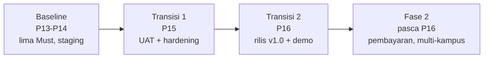

**Status:** Ada. Roadmap dan rencana migrasi per gate, 27 November 2026.

# P15 — Architecture Roadmap dan Migration Plan

**Pemilik:** Hanan Rizqullah (CEO/PO)
**Dasar:** TOGAF Phase E–F, `Skenario_Project ASP R001.txt` hlm. 24, 28, dan 32.
**Menggantikan:** roadmap lima minggu/M1–M6 pada laporan Phase F (SK-011). Roadmap lama dianggap historis.

## 1. Posisi sekarang (baseline)

| Hal | Keadaan 27 November 2026 |
|---|---|
| P13 | Selesai internal, Gate 1 belum dinilai dosen |
| P14 | Lima Must berjalan, 76 tes lulus, staging lewat tunnel |
| Data | 14 tabel di MySQL 8.0.43, backup dan restore terbukti |
| Biaya | TCO 12 bulan: Rp5,81 juta (Biznet) sampai Rp7,91 juta (Hetzner) |
| Gap | 20 butir, 9 di antaranya harus ditutup sebelum Gate 3 |
| UAT | Belum dijalankan |

## 2. Plateau

| Plateau | Isi | Kriteria keluar |
|---|---|---|
| Baseline | Artefak P13, lima Must, staging, TCO, gap analysis | Gate 2 dinilai dosen |
| Transisi 1 | Verifikasi KTM, hardening, UAT, SUS, backup offsite | Gate 3 hijau atau kuning |
| Transisi 2 | Rilis v1.0, deploy demo, pitch, peer assessment | Final panel P16 |
| Fase 2 | Payment gateway, multi-kampus, mobile, rekomendasi | belum dijanjikan |

## 3. Work package

| WP | Lingkup | Deliverable | Pemilik | Gate | Prasyarat | Estimasi |
|---|---|---|---|---|---|---|
| WP1 | Verifikasi KTM dan antrean admin | Unggah KTM, layar admin, keputusan setuju/tolak | Fharel dan Fazha | P15 | Skema `student_verifications` | 2 hari |
| WP2 | Sengketa dan aturan deposit | Buka sengketa, keputusan admin, potong/kembalikan deposit | Fazha | P15–P16 | WP1 selesai | 2 hari |
| WP3 | Hardening | Rate limit, HSTS, MFA admin, ekspor realm Keycloak | Mahesa | P15 | Staging hidup | 1 hari |
| WP4 | UAT dan SUS | Skenario tugas, tiga pengguna proksi atau mitra, skor SUS, laporan | Fharel dan Hanan | P15 | WP1 selesai | 2 hari |
| WP5 | Backup offsite dan penjadwalan | Bucket terpisah, jadwal harian, bukti restore ulang | Mahesa | P15 | TCO disetujui | 1 hari |
| WP6 | Rilis v1.0 dan deploy demo | Tag v1.0, changelog, panduan pengguna, URL demo stabil | Fazha dan Mahesa | P16 | WP1–WP5 selesai | 2 hari |
| WP7 | Roadmap fase 2 | Daftar fitur lanjutan dan syaratnya | Hanan | P16 | Gate 3 | 1 hari |

Estimasi adalah perkiraan kerja, bukan janji. Total sekitar 11 hari orang, tersebar sampai P16.

## 4. Urutan dan ketergantungan

1. WP3 lebih dulu karena murah dan menutup temuan keamanan.
2. WP1 membuka WP4; UAT tidak berarti tanpa verifikasi pengguna.
3. WP5 dikerjakan paralel dengan WP4.
4. WP2 setelah WP1 karena memakai data verifikasi dan handover.
5. WP6 dan WP7 setelah Gate 3.

## 5. Migration plan

### 5.1 Data mitra dari spreadsheet

| Langkah | Isi | Pemeriksaan |
|---|---|---|
| 1 | Minta berkas sumber dan izin pemakaian | Tertulis, bukan lisan |
| 2 | Petakan kolom ke `users`, `items`, `item_categories` | Setiap kolom punya tujuan atau dibuang dengan alasan |
| 3 | Anonimkan nama dan kontak | Tidak ada data pribadi di staging |
| 4 | Impor ke database uji | Jumlah baris sebelum dan sesudah sama |
| 5 | Periksa relasi dan constraint | Tidak ada FK menggantung |
| 6 | Catat rollback | Snapshot sebelum impor disimpan |

### 5.2 Aplikasi dari laptop ke VPS

| Langkah | Isi | Rollback |
|---|---|---|
| 1 | Buat snapshot database | Berkas dump bertanggal |
| 2 | Siapkan VPS dan Docker Compose | Laptop tetap hidup |
| 3 | Impor dump ke VPS | Database lama tidak disentuh |
| 4 | Ekspor realm Keycloak, impor ke VPS | Realm lama tetap ada |
| 5 | Arahkan DNS atau tunnel ke VPS | Kembalikan DNS bila gagal |
| 6 | Uji login, katalog, booking, unggah foto | Jika gagal, kembalikan ke laptop |

### 5.3 Identitas

Realm diekspor sebagai JSON sebelum pindah. Pengguna dicocokkan lewat email terverifikasi. Bila IdP kampus tersedia, Keycloak menjadi broker, bukan pengganti.

## 6. Milestone

| Milestone | Kriteria | Bukti |
|---|---|---|
| M1 — Gate 2 | Dua Must live, staging, ADR, CR | `07_Evidence/P14-Gate-2.md` |
| M2 — Hardening selesai | Rate limit, HSTS, MFA, realm diekspor | `04_Technology/P14-Security-Checklist.md` diperbarui |
| M3 — UAT selesai | Tiga pengguna, skor SUS, temuan dicatat | `07_Evidence/P15-UAT-SUS.md` |
| M4 — Gate 3 | MVP lengkap, UAT, roadmap, restore | `07_Evidence/P15-Gate-3.md` |
| M5 — Rilis v1.0 | Tag, changelog, panduan | `08_Source/CHANGELOG.md` |
| M6 — Demo Day | Pitch 7 menit, demo live, video cadangan | `09_Pitch/` |

## 7. Risiko

| Risiko | Dampak | Mitigasi |
|---|---|---|
| Mitra UAT tidak tersedia | Bukti pengguna lemah | Tiga pengguna proksi dengan profil jelas |
| VPS belum dibeli | Demo bergantung laptop | Tunnel + video cadangan |
| Satu orang mengerjakan banyak WP | Bottleneck | Bagi WP3 dan WP5 ke Mahesa, WP1 ke Fharel |
| Promo hosting berakhir | TCO naik | Anggaran memakai harga normal sebagai batas atas |
| Waktu P15 mepet | Gate 3 kuning | Dahulukan WP3 dan WP1 |

## 8. Di luar roadmap

Payment gateway asli, chat real-time, aplikasi mobile, multi-kampus, rekomendasi machine learning, asuransi, loyalty, white-label, dan analitik lanjutan. Semua itu fase 2 dan tidak dijanjikan pada P16.
